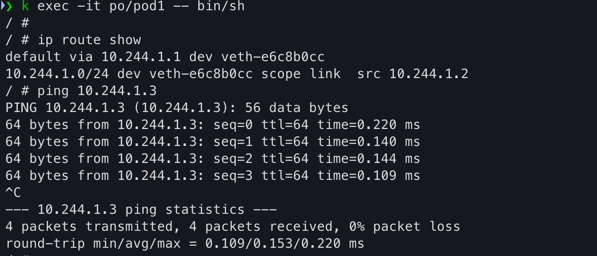
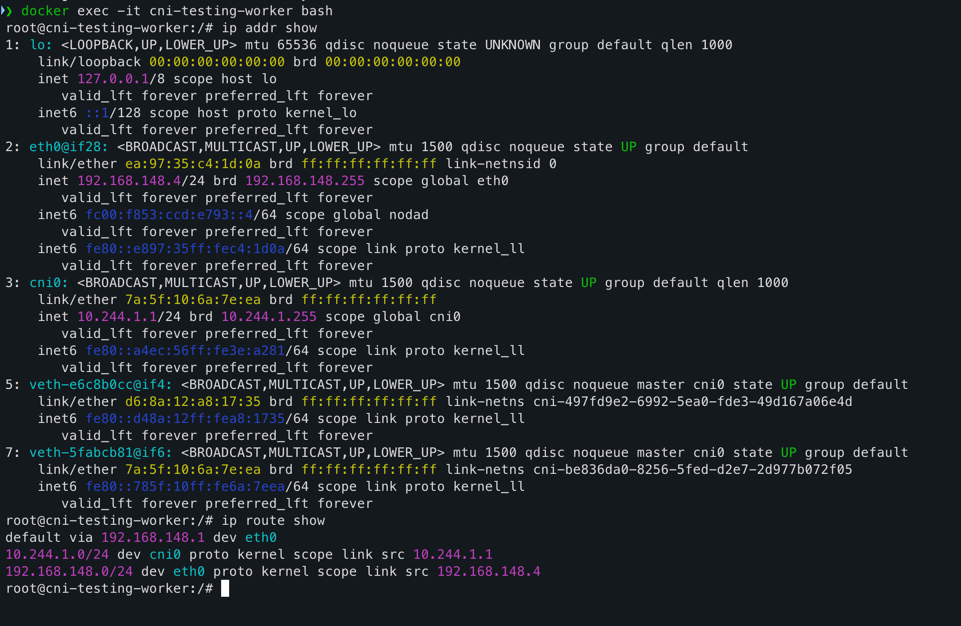

# Testing the CNI plugin on kind

End-to-end test of the plugin against a 2-node kind cluster (`control-plane` + `worker`) with the default CNI disabled.

## Prerequisites

- Docker, `kind`, `kubectl`, Go
- Run everything from the repo root.

## 1. Build the CNI binary

The binary must exist **before** the cluster is created. `kind-config.yaml` bind-mounts `./cni-plugin` into each node at `/opt/cni/bin/cni-plugin`. If the path doesn't exist, Docker creates an empty directory there and kubelet fails with `failed to find plugin "cni-plugin" in path [/opt/cni/bin]`.

Check the node architecture first (`aarch64` = arm64, `x86_64` = amd64). On a fresh setup, use your host arch (Apple Silicon = arm64):

```bash
# if a stale empty directory exists from a previous run, remove it
[ -d cni-plugin ] && rmdir cni-plugin

GOOS=linux GOARCH=arm64 CGO_ENABLED=0 go build -o cni-plugin ./cmd
file cni-plugin   # must say: ELF 64-bit LSB executable
```

## 2. Review the per-node conflists

Each node gets its own pod subnet through its own conflist. The files live in `static-nw-conflist/` and are mounted into `/etc/cni/net.d/` by `kind-config.yaml`.

| Node | Conflist | Pod subnet |
|------|----------|------------|
| control-plane | `static-nw-conflist/10-cni-scratch-itch.conflist` | `10.244.0.0/24` |
| worker | `static-nw-conflist/10-cni-scratch-itch-worker.conflist` | `10.244.1.0/24` |

The `type` field must match the binary filename in `/opt/cni/bin/` (`cni-plugin`). Edit `bridge` and `subnet` in these files if you want different values. Subnets must not overlap between nodes.

## 3. Create the cluster

`kind-config.yaml` has `disableDefaultCNI: true` and mounts the binary and conflists into each node, so no manual copy is needed.

```bash
kind create cluster --name cni-testing \
  --config kind-config.yaml \
  --kubeconfig /Users/himanshu.negi/.kube/cni-kube

export KUBECONFIG=/Users/himanshu.negi/.kube/cni-kube
kubectl get nodes
```

Verify the files landed in the nodes:

```bash
for n in cni-testing-control-plane cni-testing-worker; do
  docker exec $n ls -la /opt/cni/bin/cni-plugin /etc/cni/net.d/
done
```

### Updating the binary or conflist later

Rebuilding creates a new file, so a bind-mounted node may keep the old one. Either recreate the cluster (`kind delete cluster --name cni-testing`, then repeat step 3) or copy the files in by hand (this fails if the mount is `readOnly`):

```bash
for n in cni-testing-control-plane cni-testing-worker; do
  docker cp cni-plugin $n:/opt/cni/bin/cni-plugin
done
docker cp static-nw-conflist/10-cni-scratch-itch.conflist \
  cni-testing-control-plane:/etc/cni/net.d/10-cni-scratch-itch.conflist
docker cp static-nw-conflist/10-cni-scratch-itch-worker.conflist \
  cni-testing-worker:/etc/cni/net.d/10-cni-scratch-itch.conflist
```

## 4. Load the busybox image

```bash
docker pull --platform linux/arm64 busybox:1.36
docker save --platform linux/arm64 busybox:1.36 -o busybox.tar
kind load image-archive busybox.tar --name cni-testing
rm busybox.tar
```

`kind load docker-image` can fail with `content digest ... not found` on Docker Desktop with the containerd image store. The save/archive route avoids that. Alternatively skip this step and let the nodes pull the image (`imagePullPolicy: IfNotPresent`).

## 5. Create the namespace and apply the pods

```bash
kubectl create namespace test
kubectl apply -f test-manifests/pods.yaml
kubectl get pods -n test -o wide
```

Both pods should reach `Running` with an IP from the worker's `10.244.1.0/24` subnet. Each runs `sleep 10800` (3 hours). Change the value in `test-manifests/pods.yaml` to run longer.

If pods are stuck, inspect the events and kubelet logs:

```bash
kubectl describe pod -n test pod1
docker exec cni-testing-worker journalctl -u kubelet --no-pager | tail -50
```

## 6. Exec into the pods

```bash
kubectl exec -it -n test pod1 -- sh
```

Inside the pod:

```sh
ip addr
ip route
```

Pod-to-pod ping (same node):

```bash
POD2_IP=$(kubectl get pod -n test pod2 -o jsonpath='{.status.podIP}')
kubectl exec -n test pod1 -- ping -c3 $POD2_IP
```

Expected output:



## 7. Verify the routes on the worker node

Exec into the worker node container:

```bash
docker exec -it cni-testing-worker bash
```
You will see something like this if you run `ip route show` or `ip addr` from inside the docker container node:



Or run the commands directly:

```bash
docker exec cni-testing-worker ip route show
docker exec cni-testing-worker ip addr
```

Expected on the worker:

- `ip route show` includes the pod subnet on the bridge: `10.244.1.0/24 dev cni0 proto kernel scope link src 10.244.1.1`, plus the default route and the Docker network route on `eth0`.
- `ip addr` shows `cni0` with `10.244.1.1/24`, and one `veth*` interface per pod, all `UP` and attached to `cni0` (`master cni0`).

Confirm the veths are attached to the bridge:

```bash
docker exec cni-testing-worker ip link show master cni0
```

## Known limitations

- **Cross-node pod connectivity is not implemented yet.** The worker has no route to the control-plane's pod subnet (`10.244.0.0/24`), so pods on different nodes can't reach each other. Both test pods are pinned to the worker for this reason.
- `DEL` and `CHECK` are not implemented, so deleting a pod may leave veths and IP allocations behind.
- To try cross-node traffic with static routes (both nodes share a Docker L2 network):

  ```bash
  docker exec cni-testing-worker ip route add 10.244.0.0/24 via <control-plane-node-ip>
  docker exec cni-testing-control-plane ip route add 10.244.1.0/24 via <worker-node-ip>
  ```

  Get the node IPs with `kubectl get nodes -o wide`.

## Cleanup

```bash
kubectl delete namespace test
kind delete cluster --name cni-testing
```
