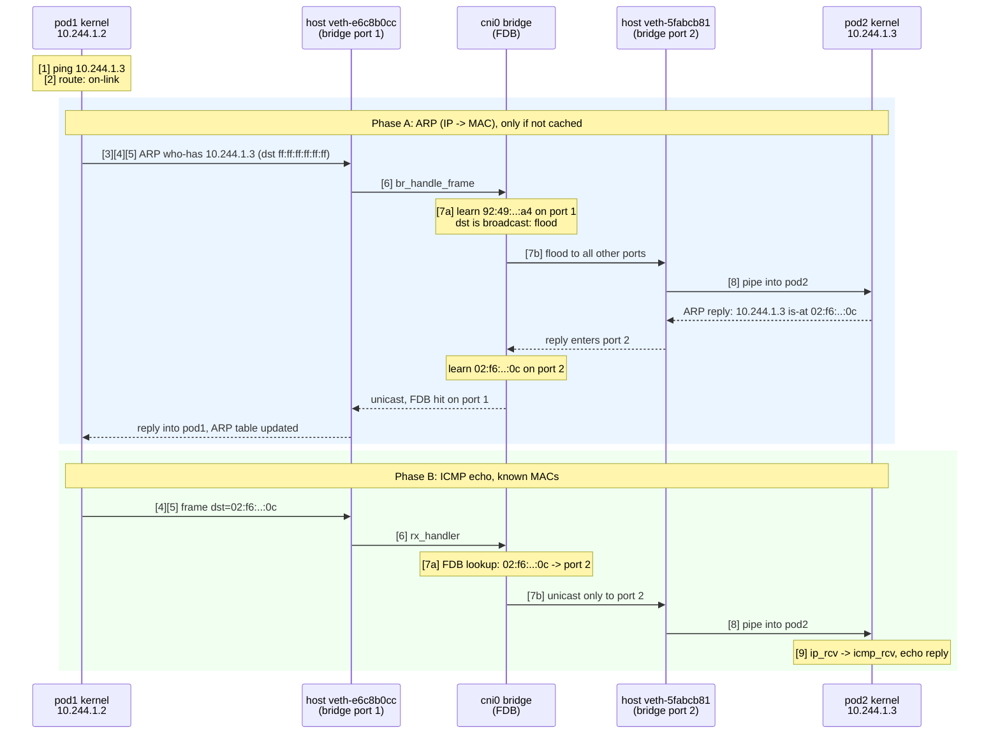

# How pod-to-pod networking works with the bridge + veth approach

This document explains what this plugin builds on each node, and what the Linux kernel does with a packet as it travels from one pod to another. Function names refer to the Linux 5.x/6.x network stack, and they shift slightly between kernel versions. Use them as search terms in the kernel source, not as stable API.

## 1. What the plugin builds

For every pod `ADD`, the plugin (see `internal/actions/add.go`) does the following on the node:

1. **Bridge:** creates the bridge `cni0` if it doesn't exist and brings it up (`EnsureBridge`).
2. **Gateway address:** assigns the first address of the node's pod subnet to the bridge, for example `10.244.1.1/24` (`EnsureBridgeAddress`).
3. **IPAM:** allocates a pod IP from the subnet, skipping the gateway (`AllocateIP`).
4. **Veth pair:** creates a veth pair (`CreateVethPair`):
   - the **host end** `veth-<hash>` stays in the node's network namespace and is enslaved to `cni0`;
   - the **container end** is moved into the pod's network namespace, given the pod IP, brought up, and given a default route via `10.244.1.1`.

Resulting topology on one node:

```
 ┌──────────── pod1 netns ────────────┐   ┌──────────── pod2 netns ────────────┐
 │ veth-aaaa  10.244.1.2/24           │   │ veth-bbbb  10.244.1.3/24           │
 │ default via 10.244.1.1             │   │ default via 10.244.1.1             │
 └──────────────┬─────────────────────┘   └──────────────┬─────────────────────┘
                │ (veth pair)                            │ (veth pair)
 ┌──────────────┴─────────────────────── node (host) netns ─────────────────────┐
 │  veth-aaaa ─────┐                                   ┌───── veth-bbbb         │
 │   (bridge port) │                                   │  (bridge port)         │
 │               ┌─┴───────────────────────────────────┴─┐                      │
 │               │      cni0  (L2 bridge / software      │  10.244.1.1/24       │
 │               │       switch, has its own IP + MAC)   │                      │
 │               └───────────────────┬───────────────────┘                      │
 │                                   │ host IP stack (routing, iptables)        │
 │                                   └──── eth0 192.168.148.x ──► Docker network│
 └──────────────────────────────────────────────────────────────────────────────┘
```

Notes on this plugin's naming:

- The host end and the container end are both named `veth-<hash>`, where `<hash>` is the first 8 hex characters of the MD5 of the container ID. They don't clash because they live in different network namespaces. The pod interface is **not** called `eth0`.
- The container end is created with the temporary name `peer-<hash>`. It is renamed after being moved into the pod namespace.
- `lo` inside the pod comes from the chained `loopback` plugin in the conflist.

## 2. Concepts the kernel relies on

### 2.1 A network namespace is a pointer, not a copy

Each `struct net_device` (interface) belongs to exactly one `struct net` (network namespace), reachable through `dev_net(dev)`. A namespace owns its own:

- interface list,
- routing tables (FIB),
- neighbour (ARP) tables,
- netfilter/iptables state,
- socket lookup tables.

"Moving an interface into a pod namespace" (`netlink.LinkSetNsFd`) just re-parents that device to another `struct net`. Nothing is copied. Packet processing always uses the namespace of `skb->dev`, the device the packet is currently attached to.

### 2.2 The `sk_buff` (socket buffer)

Every packet in the kernel is a `struct sk_buff` (skb). It holds:

- pointers into the packet data (`head`, `data`, `tail`, `end`), plus protocol header offsets (`mac_header`, `network_header`, `transport_header`),
- `skb->dev`, the interface the packet is currently on,
- `skb->protocol` (for example `ETH_P_IP`, `ETH_P_ARP`),
- `skb->sk`, the owning socket on the send side,
- `skb_dst(skb)`, the cached routing decision,
- netfilter connection-tracking state, marks and timestamps.

Headers are added by moving the `data` pointer back (`skb_push`) and stripped by moving it forward (`skb_pull`). The payload is generally not copied between layers. The same skb is handed down the transmit path, across the veth, and up the receive path of the peer device.

### 2.3 veth: a virtual cable

A veth pair is two `net_device`s whose transmit functions are cross-wired. Whatever is transmitted on one end is received on the other. There is no wire, no DMA and no hardware queue. The driver is `drivers/net/veth.c`.

### 2.4 The bridge: a software L2 switch

`cni0` is a `net_device` of type bridge (`net/bridge/`). Interfaces enslaved to it are **ports**. For each port the bridge registers an `rx_handler`, so frames received on a port are diverted to the bridge before the IP stack sees them. The bridge keeps a **forwarding database (FDB)** that maps MAC address to port, which it learns from source MACs of frames it sees.

A bridge device also has its own MAC address and IP. Frames addressed to the bridge itself are passed up to the host IP stack.

## Diagram: same-node pod1 → pod2 (numbered steps)

The numbers `[1]`–`[9]` match **Step 1–9** in section 3 below. MACs and interface names are the ones from a real run of this plugin on the `cni-testing-worker` node.

```
   POD 1  (own netns)                                                POD 2  (own netns)
┌──────────────────────────────┐                          ┌──────────────────────────────┐
│ [1] ping 10.244.1.3          │                          │ [9] ip_rcv -> icmp_rcv       │
│     sendmsg() builds an skb  │                          │     echo request delivered   │
│ [2] ROUTE TABLE              │                          │                              │
│     10.244.1.0/24 on-link    │                          │ veth-5fabcb81   (pod end)    │
│     -> no gateway needed     │                          │ mac 02:f6:c9:a6:f2:0c        │
│ [3] ARP TABLE                │                          │ ip  10.244.1.3/24            │
│     10.244.1.3               │                          │                              │
│       = 02:f6:c9:a6:f2:0c    │                          │                              │
│                              │                          │                              │
│ veth-e6c8b0cc   (pod end)    │                          │                              │
│ mac 92:49:62:72:60:a4        │                          │                              │
│ ip  10.244.1.2/24            │                          │                              │
└──────────────┬───────────────┘                          └──────────────▲───────────────┘
               │ [4] veth_xmit                                           │ [8] veth_xmit (peer)
═══════════════╪═══════════════ namespace boundary ═════════════════════╪════════════════
               │ [5] skb->dev = host end, netns = host                   │ skb->dev = pod end, netns = pod 2
               ▼                                                         │
     veth-e6c8b0cc  (host end)                                veth-5fabcb81  (host end)
     mac d6:8a:12:a8:17:35  [permanent]                       mac 7a:5f:10:6a:7e:ea  [permanent]
     = bridge PORT 1                                          = bridge PORT 2
               │ [6] rx_handler -> br_handle_frame                       ▲
               ▼                                                         │ [7b] br_forward -> dev_queue_xmit
     ┌───────────────────────────────────────────────────────────────────┴───────────┐
     │ cni0   software switch in the HOST netns          gateway 10.244.1.1/24       │
     │                                                                               │
     │ [7a] FDB  (MAC -> port)                                                       │
     │      92:49:62:72:60:a4  ->  PORT 1  veth-e6c8b0cc   [dynamic, learned]        │
     │      02:f6:c9:a6:f2:0c  ->  PORT 2  veth-5fabcb81   [dynamic]  <-- lookup hit │
     └───────────────────────────────────────────────────────────────────────────────┘
```

How to read it:

- **Down the left:** pod1 decides it's on-link `[2]`, resolves the MAC with ARP `[3]`, and the frame goes through the veth pipe `[4]` into the host namespace `[5]`.
- **Middle:** the bridge takes over `[6]`, learns the source MAC and looks up the destination MAC `[7a]`, then transmits out of the matching port `[7b]`.
- **Up the right:** the second veth pipe `[8]` carries the frame into pod2's namespace, where the IP stack finally sees it `[9]`.
- The host IP stack is never involved. Everything between `[5]` and `[8]` is layer 2.

### The same flow as a sequence



### Which table lives where

```
 ┌───────────────────────────────┬───────────────────┬────────────────────────────────────┐
 │ Table                         │ Lives in          │ Question it answers                │
 ├───────────────────────────────┼───────────────────┼────────────────────────────────────┤
 │ Route table      (ip route)   │ each pod netns    │ on-link, or send to a gateway?     │
 │ ARP/neigh table  (ip neigh)   │ each pod netns    │ IP  -> MAC                         │
 │ FDB              (bridge fdb) │ host netns, cni0  │ MAC -> bridge port                 │
 └───────────────────────────────┴───────────────────┴────────────────────────────────────┘
```

### Reading `bridge fdb show br cni0`

```
 92:49:62:72:60:a4 dev veth-e6c8b0cc master cni0                  <- dynamic: the POD end's MAC,
                                                                     learned from frames on this port
 d6:8a:12:a8:17:35 dev veth-e6c8b0cc master cni0 permanent        <- permanent: the HOST end's own MAC
 d6:8a:12:a8:17:35 dev veth-e6c8b0cc vlan 1 master cni0 permanent <- same entry in the default VLAN 1
 33:33:00:00:00:01 dev veth-e6c8b0cc self permanent               <- multicast filter on the port
```

| FDB flag | Meaning | MAC belongs to |
|----------|---------|----------------|
| *(none)* | Dynamic, learned from traffic, ages out after about 300 s | The **pod-side** veth end behind the port |
| `permanent` | Local entry added when the port joined the bridge | The **host-side** veth end (the port itself) |
| `self` | Programmed on the device itself, not learned | Multicast filters |

### Off-subnet traffic (gateway path)

When the destination is **outside** `10.244.1.0/24`, step `[2]` picks the default route instead, and the frame is addressed to the bridge itself:

```
 pod1:  [2] route: default via 10.244.1.1        (not on-link)
        [3] ARP for 10.244.1.1  ->  cni0's own MAC
              │
              ▼   frame dst MAC = cni0 MAC, IP dst = final destination (unchanged)
 host veth ──[6]──► cni0 FDB: dst MAC is the bridge itself
                       │ br_pass_frame_up   (skb->dev = cni0)
                       ▼
                host IP stack: ip_rcv -> route lookup -> ip_forward -> eth0 / vxlan0
```

## 3. The packet's journey: pod1 → pod2 on the same node

Example: pod1 `10.244.1.2` runs `ping 10.244.1.3` (pod2). Both are in `10.244.1.0/24`.

### Step 1: Application and socket layer (pod1 netns)

- `ping` opens an ICMP socket and calls `sendmsg()`. The thread is executing inside pod1's network namespace, because the process is a member of it.
- The kernel allocates an `sk_buff`, copies the ICMP echo payload in from user space (this is the one real copy), and sets `skb->sk`.
- The IP layer (`ip_push_pending_frames` / `ip_queue_xmit`) needs a route.

### Step 2: Routing decision (pod1 netns FIB)

The FIB lookup uses **pod1's** routing table only:

```
10.244.1.0/24 dev veth-aaaa proto kernel scope link src 10.244.1.2   <- added when the address was assigned
default via 10.244.1.1 dev veth-aaaa                                   <- added by the plugin
```

`10.244.1.3` matches the connected `/24` route, so the destination is **on-link**. The next hop is the destination itself, and the output device is `veth-aaaa`. The host's routing table is never consulted. The result is cached on the skb as a `dst_entry`.

### Step 3: Neighbour resolution (ARP)

To build the Ethernet header the kernel needs pod2's MAC address. `ip_finish_output2` looks up the neighbour entry for `10.244.1.3` on `veth-aaaa` in pod1's neighbour table.

- **No entry:** the original skb is queued on the neighbour entry, and `arp_send` builds an **ARP request** (`ff:ff:ff:ff:ff:ff`, "who has 10.244.1.3, tell 10.244.1.2"). That ARP frame is itself an skb that goes through steps 4–7 below.
- **Entry exists:** the MAC is written with `dev_hard_header` and the packet goes straight to step 4.

### Step 4: Transmit on the pod's veth end

`dev_queue_xmit(skb)` runs. veth devices use the `noqueue` qdisc, so the skb goes directly to `dev_hard_start_xmit`, which calls the driver's `ndo_start_xmit`: `veth_xmit` (pod1 end).

### Step 5: Crossing the namespace boundary (the veth peer)

This is the "move from the pod namespace to the host namespace" step. `veth_xmit` does roughly this:

1. Takes the peer device (`veth-aaaa` host end, which lives in the **host** netns).
2. Calls `veth_forward_skb` → `__dev_forward_skb(peer, skb)`, which:
   - **scrubs** the skb (`skb_scrub_packet(skb, xnet=true)` when the namespaces differ). That clears netfilter/conntrack state, the cached `dst`, the mark and the socket ownership. The packet is a fresh arrival from the host's point of view;
   - sets `skb->dev = peer`. From now on `dev_net(skb->dev)` is the host namespace;
   - sets `skb->protocol = eth_type_trans(skb, peer)`, which sets the packet type (unicast, broadcast or other-host) from the destination MAC.
3. Queues the skb to the per-CPU backlog (`netif_rx`), which raises the `NET_RX` softirq, or hands it to NAPI if XDP/GRO is in use.

The data is not copied. The same buffer now belongs to a device in another namespace. This is how a packet "enters the host namespace" without any routing at all.

### Step 6: Receive path on the host end → bridge `rx_handler`

The softirq runs `process_backlog` → `__netif_receive_skb_core`. Before IP processing, the core checks whether the receiving device has an `rx_handler`. The host veth end does, because `LinkSetMaster` (`br_add_if` in the kernel) registered one with `netdev_rx_handler_register`. So:

- `br_handle_frame` is called for the frame instead of `ip_rcv`.
- **Because of this, the host IP stack never sees pod-to-pod traffic.** The frame is switched at L2 and is not routed.

### Step 7: Bridge learning and forwarding

`br_handle_frame` → `br_handle_frame_finish`:

1. **Learn:** `br_fdb_update` records "pod1's MAC is behind port `veth-aaaa`".
2. **Forward decision:** it looks up the destination MAC with `br_fdb_find_rcu`.
   - **Broadcast or unknown unicast** (the ARP request): flood to all other ports with `br_flood`. Every pod's veth on the node sees it, but only pod2 answers.
   - **Known unicast** (the ICMP echo after ARP completes): `br_forward` → `__br_forward` → `br_dev_queue_push_xmit` → `dev_queue_xmit` on the destination port, `veth-bbbb` (host end of pod2).
   - **Destination MAC is the bridge's own MAC** (traffic to the gateway `10.244.1.1`, or to anything routed off-node): `br_pass_frame_up` re-injects the skb with `skb->dev = cni0`, and the **host IP stack** takes over from there.

### Step 8: Into pod2's namespace

`dev_queue_xmit` on `veth-bbbb` (host end) → `veth_xmit` → `__dev_forward_skb` to its peer, the pod2 end. The skb is scrubbed again, `skb->dev` becomes pod2's interface, and the netns is now pod2's.

### Step 9: Receive in pod2

- `__netif_receive_skb_core` → `ip_rcv` → the FIB local table confirms `10.244.1.3` is local → `ip_local_deliver` → `icmp_rcv`.
- The kernel generates the echo reply, and the same journey runs in reverse. The bridge already learned both MACs, so the reply is a direct unicast with no flooding.

Condensed:

```
pod1 app ─sendmsg─► skb ─► ip route (pod1 FIB) ─► ARP/neigh ─► dev_queue_xmit
   ─► veth_xmit(pod1 end) ═══ __dev_forward_skb: skb->dev = host veth, netns = host ═══►
   netif_rx ─► softirq ─► rx_handler=br_handle_frame ─► FDB learn + lookup
   ─► br_forward ─► dev_queue_xmit(host veth of pod2) ─► veth_xmit
   ═══ __dev_forward_skb: skb->dev = pod2 veth, netns = pod2 ═══► netif_rx
   ─► ip_rcv ─► icmp_rcv ─► reply
```

## 4. Other paths through the same setup

| Destination | Route in pod | Path | Needs host routing? |
|-------------|--------------|------|---------------------|
| Another pod, same node | on-link `/24` | veth → bridge L2 switch → veth | No |
| Gateway `10.244.1.1` | on-link `/24` | veth → bridge → `br_pass_frame_up` → host IP stack (local delivery) | No |
| Node IP / other node / internet | default via `10.244.1.1` | veth → bridge → host IP stack → forward via route | Yes (`ip_forward=1` and a route) |
| Pod on another node | default via `10.244.1.1` | reaches the host, but the host has no route for the other node's pod CIDR | **Not implemented** |

For off-node traffic, the packet arrives at the host with `skb->dev = cni0` and goes through `ip_rcv` → routing → `ip_forward`. Two things are still missing for a complete setup:

- **Cross-node routes** (static routes or a VXLAN overlay) for the other nodes' pod CIDRs.
- **Masquerade/SNAT** for traffic leaving the cluster network, with source IPs in `10.244.x.x` rewritten to the node IP.

## 5. Netfilter and the bridge (`br_netfilter`)

Bridged frames normally skip iptables. If the `br_netfilter` module is loaded and `net.bridge.bridge-nf-call-iptables=1`, the bridge path calls into the iptables hooks (`NF_BR_*` and the IP hooks). Kubernetes relies on this so that `kube-proxy` Service rules (DNAT in `nat PREROUTING`) apply to traffic between pods on the same bridge.

Check it on a node:

```bash
docker exec cni-testing-worker sysctl net.bridge.bridge-nf-call-iptables
docker exec cni-testing-worker lsmod | grep br_netfilter
```

## 6. Observing it on the kind cluster

Run on the worker node (`docker exec -it cni-testing-worker bash`):

```bash
# bridge, its ports and learned MACs
ip -d link show cni0
bridge link show                  # lists veth ports with "master cni0"
bridge fdb show br cni0           # MAC -> port table (what step 7 reads)

# match a pod's interface to its host-side veth
POD_PID=$(crictl inspect --output go-template --template '{{.info.pid}}' $(crictl ps --name busybox -q | head -1))
nsenter -t "$POD_PID" -n ip -d link show      # note the "@ifN" peer index
ip link | grep "^N:"                          # replace N with that index: it is the host end

# ARP/neighbour tables are per namespace
nsenter -t "$POD_PID" -n ip neigh
ip neigh

# watch a ping cross each hop
tcpdump -ni veth-aaaa icmp        # pod1's host end
tcpdump -ni cni0 icmp             # the bridge
tcpdump -ni veth-bbbb icmp        # pod2's host end
```

If `tcpdump` isn't in the kind node image, attach a tools container to the node's network namespace:

```bash
docker run --rm -it --net container:cni-testing-worker nicolaka/netshoot tcpdump -ni cni0 icmp
```

To watch the kernel functions themselves, trace them with `bpftrace` or `perf` on the node, for example `veth_xmit` and `br_handle_frame`. This needs privileges and kernel headers or BTF in the node.

## 7. Limitations of the current design

- **Interface MTU** is not set on the veths, so it defaults to 1500. An overlay such as VXLAN later needs a lower MTU (about 1450) to leave room for the encapsulation header.
- **`DEL` is a no-op**, so veths and IPAM entries leak when pods are deleted. The kernel removes a veth automatically when its pod namespace is destroyed, but the allocation files under `/var/lib/cni/` remain.
- **`CHECK` is a no-op.**
- **Cross-node connectivity** is not implemented.
- **No masquerade**, so pods can't reach external addresses that don't know the pod CIDR.

## References

- Linux `veth` driver: `drivers/net/veth.c`
- Linux bridge: `net/bridge/br_input.c`, `br_forward.c`, `br_fdb.c`
- Core receive path: `net/core/dev.c` (`__netif_receive_skb_core`, `__dev_forward_skb`)
- Kernel docs on `sk_buff`: https://docs.kernel.org/networking/skbuff.html
- `ip-netns(8)`, `bridge(8)`, `veth(4)` man pages
- CNI spec: https://github.com/containernetworking/cni/blob/main/SPEC.md
